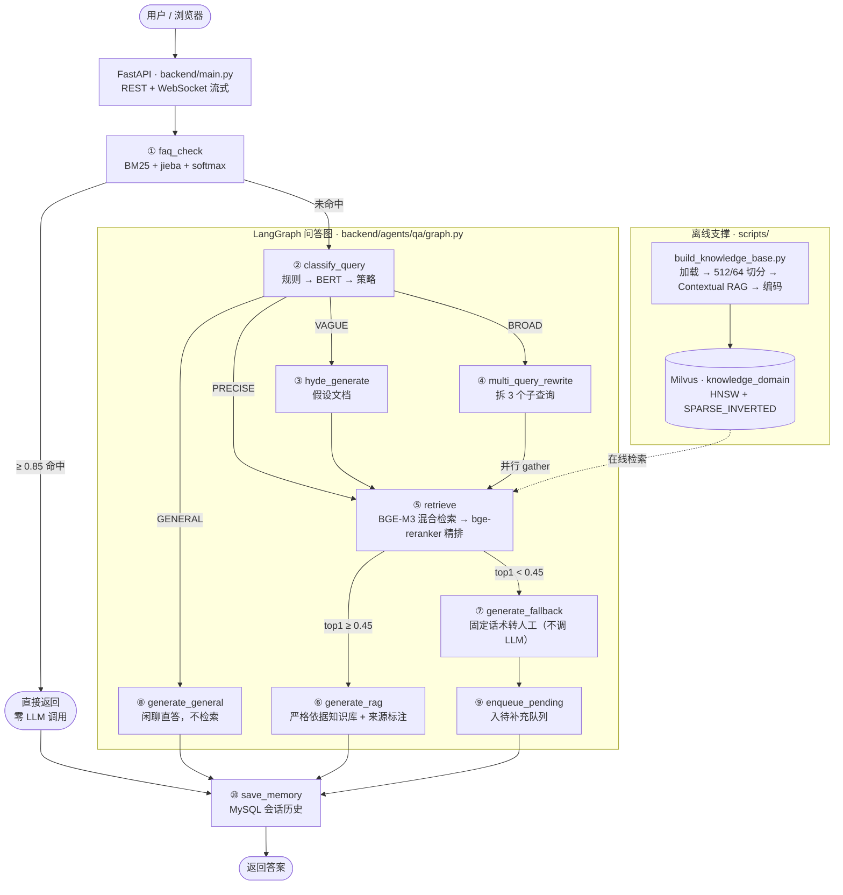

# DeliRAG · 智慧出品熟食连锁智能问答系统

基于 **LangGraph 单图编排 + FAQ 热路径** 的熟食连锁企业知识问答系统，
面向**加盟商与终端顾客**两类外部用户（门店内部不使用），
回答产品规格价格、加盟与批发政策、食品安全与储存、冷链配送等问题。

> 本 README 描述的是**当前 `backend/` 分层架构**（2026-10 重构后）。
> 课程原始版本（`rag_qa/` + `mysql_qa/` + `new_main.py`）已整体移除，
> 旧文档归档在 `_归档_旧版本文档/`（确认无误后可整目录删除）。
> 面试速查见 `docs/面试速查_DeliRAG.md`。

---

## 一、系统架构



**设计取向三句话**：成本上省（FAQ 命中零大模型调用）、安全上收（低置信拒答不硬编）、
检索上分策略（不同问题类型走不同检索路径，不是一个检索法打天下）。

---

## 二、技术栈

| 层 | 技术 |
|---|---|
| 编排 | **LangGraph**（StateGraph + 条件边 + MemorySaver 检查点） |
| 接入 | FastAPI + Uvicorn + WebSocket 流式（`start / token / end`） |
| 大模型 | **DeepSeek `deepseek-chat`**（OpenAI 兼容端点，`.env.local` 可换厂商） |
| FAQ 热路径 | MySQL 8（`faq` 表）+ Redis 7（Cache-Aside，`deli:` 前缀隔离）+ rank_bm25 + jieba 领域词 |
| 向量检索 | **Milvus 2.5.4**（单集合 `knowledge_domain`，`tenant_id` 隔离）+ **BGE-M3**（dense 1024 COSINE + sparse IP）+ `WeightedRanker(0.7, 0.3)` |
| 精排 | **bge-reranker-large**（CrossEncoder，sigmoid 分） |
| 意图分类 | 规则层 + **bert-base-chinese 微调二分类**（`models/classifier/bert_query_classifier`） |
| 文档入库 | md 按标题切 → `RecursiveCharacterTextSplitter` **512/64** → 可选 **Contextual RAG** |
| 中间件 | Docker Compose（etcd + MinIO + Milvus + Redis + MySQL） |

**端口**：Milvus `19530` · MySQL `3307` · Redis `6380`（6379 被别的项目占用）· Web `8082` · MCP `8001`

---

## 三、目录结构

```
deli_qa_system/
├── backend/                       # 应用代码（分层）
│   ├── main.py                    # FastAPI 入口：路由装配 + 启动预热 FAQ
│   ├── config.py                  # pydantic-settings 配置中心（.env.local 优先于 OS env）
│   ├── dependencies.py            # 依赖装配：FAQ / MySQL 单例
│   ├── api/v1/qa.py               # 路由：会话 / 查询 / WS 流式 / 历史 / 分类 / 健康检查
│   ├── agents/qa/                 # ★ 问答图
│   │   ├── graph.py               # 图装配 + QAGraph 门面（aanswer / astream_answer）
│   │   ├── nodes.py               # 10 个节点实现 + 规则词表 + 阈值常量
│   │   ├── state.py               # QAState 定义
│   │   └── prompts.py             # 6 个提示词（含食品安全红线）
│   ├── core/
│   │   ├── knowledge_base.py      # Milvus 客户端 + BGE-M3 编码器（单例）
│   │   ├── reranker.py            # bge-reranker 精排 + retrieve() 一体化入口
│   │   ├── query_classifier.py    # BERT 二分类（推理）
│   │   ├── llm_factory.py         # 模型工厂（按用途缓存，禁止散落 init_chat_model）
│   │   ├── memory.py              # MemorySaver + 滑动窗口裁剪
│   │   └── pending.py             # 低置信问题入待补充队列
│   ├── faq/                       # FAQ 通道：mysql_client / redis_client / bm25_search / preprocess
│   ├── ingest/                    # 文档加载（含 OCR）+ 切分
│   └── mcp/knowledge_base_server.py  # 把检索暴露为 MCP 工具（Streamable HTTP）
├── scripts/
│   ├── init_milvus.py             # 重建集合（备份旧库 → 删 → 建 schema + 索引）
│   ├── build_knowledge_base.py    # 文档入库全流程（含 docs/ 安全拦截）
│   ├── init_faq_data.py           # FAQ CSV → MySQL（增量同步）
│   ├── train_classifier.py        # 重训 BERT 分类器
│   └── evaluation/                # RAGAS 评估集、跑分脚本、评估报告
├── data/                          # ★ 唯一入库扫描根
│   ├── faq/deli_faq.csv           # 59 条问答对（+ 来源台账）
│   └── {product,safety,ops,franchise,supply}_data/   # 五类知识文档
├── models/classifier/bert_query_classifier/   # 微调分类器权重
├── training/                      # 分类器训练集与生成提示词
├── docs/                          # 业务素材：访谈提纲、内部配方（★永不入库）、设计规范
└── static/                        # 前端页面
```

---

## 四、快速开始

```bash
# 0. 环境：Python 3.11 + CUDA（RTX 3060 Ti 验证）· 依赖见 requirements-win.txt
#    .env.local 需填好 LLM_API_KEY / LLM_BASE_URL

# 1. 中间件
docker compose up -d

# 2. 建 Milvus 集合（备份旧库 → 重建 knowledge_domain + 索引）
python scripts/init_milvus.py --force

# 3. 导入 FAQ（幂等，只补缺失的问题）
python scripts/init_faq_data.py
#    ⚠️ 新增 FAQ 后必须清 Redis 语料缓存，否则 BM25 还用旧语料：
#    redis-cli -p 6380 DEL deli:qa_original_questions deli:qa_tokenized_questions

# 4. 知识库入库（--no-context 可跳过 Contextual RAG 加速）
python scripts/build_knowledge_base.py

# 5. 训练意图分类器（可选，权重已随项目提供）
python scripts/train_classifier.py --data training/deli_classifier_500.json --epochs 3

# 6. 启动 Web 服务
python 启动服务.py                                        # 封装脚本（含环境自检）
#    或：python -m uvicorn backend.main:app --host 127.0.0.1 --port 8082

# 7. 环境自检
python verify_env.py
```

打开 `http://127.0.0.1:8082`。可选启动 MCP 检索服务：`python -m backend.mcp.knowledge_base_server`

---

## 五、关键参数（`backend/config.py`）

| 参数 | 默认值 | 含义 |
|---|---|---|
| `faq_bm25_threshold` | **0.85** | FAQ 命中阈值（精确率优先：误报是错误答案，漏报只是多一次 LLM） |
| `recall_top_k` / `rerank_top_k` | 10 / 3 | 召回数 / 精排后保留数 |
| `min_relevant_score` | 0.05 | 精排分低于此值视为 ANN 噪声丢弃 |
| `high_confidence_threshold` | **0.45** | 精排 top1 低于此值 → 固定话术转人工，**不生成** |
| `chunk_size` / `chunk_overlap` | 512 / 64 | 切分参数 |
| `contextual_rag` | true | 入库时给每个 chunk 加一句上下文描述 |
| `valid_sources` | product/safety/ops/franchise/supply | 五类知识过滤 |

**召回量按策略变**：PRECISE 8 · VAGUE 10 · BROAD 每路 4（3 路并行后去重取 3）

---

## 六、数据来源与合规

| 数据 | 来源 | 状态 |
|---|---|---|
| 产品规格/价格/保质期 | 业务方价目表与产品资料 | 真实数据 |
| 食品安全/冷链/操作规范 | GB 31654-2021、GB 31605-2020、《餐饮服务食品安全操作规范》**要点整理稿** | 公开标准二次整理 |
| FAQ 59 条 | 业务方材料 + 行业通行做法 | 每条来源见 `data/faq/deli_faq_来源台账.md` |
| 分类器训练集 | LLM 按领域提示词生成 + 两轮人工质检 | 合成数据，已标注 |

**三条铁律**：

1. **内部配方绝不入库**：现拌凉菜精确配方是商业机密，归档在 `docs/内部配方_不入知识库.md`。
   `build_knowledge_base.py` 显式拦截 `docs/` 路径（`if "docs" in resolved.parts: raise`），
   物理隔离 —— 顾客问"你们黄瓜怎么拌的"套不出秘方。
2. **食品安全零幻觉**：保质期、温度、留样义务绝不能靠模型记忆回答。
   低置信走固定话术 + 人工电话，绝不硬答。
3. **价格与保质期标注时效**：答案为销售指导价 / 行业参考值，注明"以门店当日公示为准"。

---

## 七、实测数据（重构后，2026-10-09）

**RAGAS 四指标**（15 题真实链路，评估器 LLM）：

| 指标 | 全量 15 题 | 有检索语料的 13 题 |
|---|---|---|
| faithfulness 忠实度 | 0.730 | **0.843** |
| answer_relevancy 相关性 | 0.645 | 0.745 |
| context_precision 精确率 | 0.655 | 0.679 |
| context_recall 召回率 | 0.678 | 0.757 |

- 核心 7 题（价格、保质期、加热、冷链、健康证、采购）**faithfulness 全是 1.00**，相关性 0.94+
- 全量被拉低是因为 3 道题知识库无对应语料，系统**正确转人工**被指标记 0 —— 这是红线生效，不是故障
- 逐题明细见 `scripts/evaluation/评估报告_RAGAS.md`

---

## 八、已知限制与后续规划

**限制（诚实清单）**：

1. `data/franchise_data/` 为空，加盟类问题一律转人工
2. **长价目表切分不友好**：512 字符切会把大表切散，拖低 context_recall（0.678）
3. BM25 是词汇匹配：语义相近但意图不同的问题可能误命中（靠 0.85 高阈值压住）
4. 拒答闸门只看精排 top1 分数，未校验"检回内容是否含问题关键实体"
5. 荤菜保质期为行业估计值，待业务方确认

**规划**：

- [ ] 表格类文档专门切分（按行建 chunk）
- [ ] 检索相关性闸门（关键实体校验）
- [ ] FAQ 语料扩充至 150+（问题面见 `docs/竞品问题挖掘清单.md`）
- [ ] **角色权限（上线阻塞项）**：加盟商可见批发价与加盟政策，终端顾客不可见；
      当前系统**无任何鉴权**，两类用户共用同一套知识库
- [ ] 补齐 `franchise_data/` —— 加盟商是主力用户之一，但该目录目前为空
- [ ] 知识时效性治理：价格/政策类文档的版本与生效日期管理

---

## 九、工程侧要点（值得一看的实现）

- **流式只转发该转发的 token**：`astream_events(v2)` 按 `langgraph_node` 过滤，
  只有 `generate_rag` / `generate_general` 的 token 发给前端，分类/改写节点的 LLM 调用不外泄
- **同步推理不阻塞事件循环**：编码、rerank、BM25、MySQL 全走 `run_in_executor` / `asyncio.to_thread`
- **全链路降级**：MySQL / Redis / Milvus / LLM 任一不可用都有降级路径，绝不向前端抛技术错误
- **入库幂等**：`document_id = md5(相对路径)`，`chunk_id = md5(doc_id + 序号 + 内容前 50 字)`，先删后写
- **两个真实坑**：GPU fp16 下查询向量未转 float32 → Milvus 报向量类型不匹配；
  BGE 权重必须放纯 ASCII 路径（中文路径 sentencepiece 读不了）

---

## 十、相关文档

- `docs/面试速查_DeliRAG.md` — 面试拆解（主链路 / 追问应答 / 翻车点清单）
- `scripts/evaluation/评估报告_RAGAS.md` — 评估逐题明细
- `docs/DESIGN-SPEC.md` / `docs/REJECT-LIST.md` — 前端设计规范与否决清单
- `.trae/documents/deli_rag_refactor_plan.md` — 本次重构的规划与决策记录
