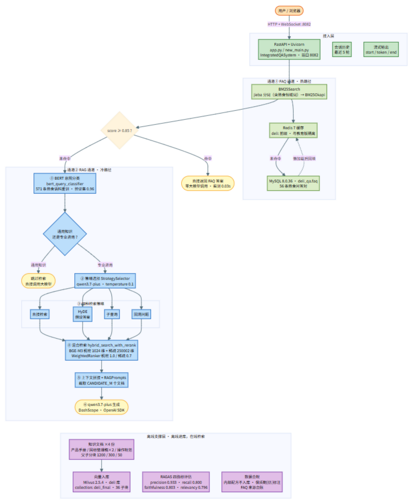

# DeliRAG 架构图与技术栈分层

> 熟食连锁企业智能问答系统（智慧出品）
> 图中每个数字都是**实测值**，来源见 `DELI_MIGRATION.md` 坑清单与 `评估报告_RAGAS.md`
> 整理时间：2026-09-29

---

## 一、整体架构图

**一图速读**（面试开场 30 秒版）：

> "双通道架构。用户问题先进 **FAQ 热路径**——jieba 分词后 BM25 打分，问题库缓存在
> Redis（`deli:` 前缀与教育版隔离），得分 ≥0.85 直接返回现成答案，**零大模型调用，实测 0.03 秒**。
> 未命中进 **RAG 冷路径**：本地 BERT 做意图分类（571 条熟食语料微调，验证集 0.96），
> 通用知识直接答；专业咨询由大模型在四种检索策略里路由（直接检索 / HyDE / 子查询 / 回溯），
> 然后 **BGE-M3 稠密+稀疏混合检索 → WeightedRanker 融合 → CrossEncoder 重排**，
> 取 Top-M 父文档拼上下文生成。离线侧：4 份领域文档父子分块入库 Milvus（36 子块），
> 并用 RAGAS 做了四指标评估。"

Mermaid 源码在 `DeliRAG架构图_整体链路.mmd`，改字后贴 [mermaid.live](https://mermaid.live) 即可重出图。

---

## 二、技术栈分层

### L0 · 接入层

| 技术 | 版本 | 本项目实现 |
|---|---|---|
| FastAPI | 0.115.12 | REST（`/api/query`、`/api/sources`、`/api/history`）+ WebSocket 流式 |
| Uvicorn | 0.41.0 | 端口 8082（与教育版 8081 并存） |
| 流式协议 | — | `start / token / end` 三段消息；`_aiter_sync` 桥接防事件循环阻塞 |

### L1 · 编排层

| 技术 | 本项目实现 |
|---|---|
| `new_main.py`（顶层编排） | FAQ 命中→直接返回；未命中→RAG；会话历史最近 5 轮；httpx `max_keepalive_connections=0` 防闲置卡顿 |
| `new_rag_system.py`（RAG 编排） | 意图分类→策略选择→检索→拼上下文→生成；`_llm_text()` 兼容流式生成器 |
| `app.py`（Web 层） | 问候语正则、会话管理、`/api/sources` 动态分类、静态托管 |

### L2 · FAQ 通道（热路径）

| 技术 | 版本 | 本项目实现 |
|---|---|---|
| MySQL | 8.0.36 | 库 `deli_qa`，表 `faq(category, question, answer)`，**56 条熟食问答** |
| PyMySQL / SQLAlchemy | 1.1.1 / 2.0.47 | utf8mb4 连接、参数化查询、幂等导入 |
| Redis | 服务端 7.x（客户端 5.3.1） | Cache-Aside 懒加载 + 答案缓存；键 `deli:` 前缀与教育版隔离 |
| rank_bm25 | 0.2.2 | BM25Okapi + softmax 归一化 + 0.85 阈值（实测过 top5 方案，因误放行弃用） |
| jieba | 0.42.1 | 分词 + **熟食领域自定义词**（虎皮鸡爪/八大拌/五香料汁/效期/报损/冷链…） |

### L3 · RAG 通道（冷路径）

| 环节 | 技术 | 版本 | 本项目实现 |
|---|---|---|---|
| 意图分类 | bert-base-chinese 微调（transformers 4.45） | 2 分类 | **571 条熟食语料重训**（含书面语样本+边界样本），验证集 0.96，GPU 训练 10.5s |
| 策略路由 | qwen3.7-plus（OpenAI SDK 2.24） | temperature 0.1 | 4 选 1，few-shot 示例为熟食问法；失败兜底"直接检索" |
| 混合检索 | Milvus 2.5.4（pymilvus 2.5.4） | — | 库 `deli` / 集合 `deli_final` / **36 个子块** / 双路 AnnSearchRequest |
| 向量 | **BGE-M3**（milvus-model 0.2.5） | — | 稠密 1024 维 + 稀疏 250002 维；GPU fp16（**查询侧已修 float32 转换**） |
| 融合 | WeightedRanker(1.0, 0.7) | — | 稠密为主、稀疏为辅；权重明确故不用 RRF |
| 重排 | **bge-reranker-large**（sentence-transformers 3.0.1 CrossEncoder） | — | 父块级重排；父块<2 跳过；`key=lambda` 防平分崩溃 |
| 生成 | qwen3.7-plus（DashScope 兼容端点） | — | 4 变量 prompt（context/history/question/phone），零幻觉兜底"转人工" |

### L4 · 数据层（离线）

| 技术 | 用途 |
|---|---|
| PyMuPDF / python-docx / python-pptx / rapidocr | 文档解析（PDF/Word/PPT/图片 OCR） |
| 中文递归切分器 + MarkdownTextSplitter | 父子分块 1200/300/50 |
| 知识文档 ×4 份 | 产品手册（业务方真实材料）/ GB 31654 整理稿 / GB 31605 整理稿 / 餐饮操作规范整理稿 → 5 类知识目录 |
| Milvus + etcd v3.5.16 + MinIO | 向量持久化（`source` 字段支撑分类过滤） |

### L5 · 评估层

| 技术 | 结果 |
|---|---|
| RAGAS 0.2.6（评估器 qwen3.7-flash + qwen3.7-text-embedding） | **precision 0.933 / recall 0.800 / faithfulness 0.803（排除拒答类 0.889）/ relevancy 0.796（排除拒答类 0.920）** |
| 评估集 | 15 题经**真实链路**生成 answer+contexts（含 2 道诚实性测试） |

### L6 · 部署层

| 技术 | 说明 |
|---|---|
| Docker Compose | 5 容器：etcd v3.5.16 + MinIO + Milvus 2.5.4 + Redis 7 + MySQL 8.0.36（与教育版**共用**） |
| Attu v2.4 | Milvus 可视化 |
| Python | 3.11 + torch 2.10.0+cu126（RTX 3060 Ti 验证） |

---

## 三、大模型调用次数（成本模型）

| 路径 | LLM 调用 | 实测延迟 |
|---|---|---|
| FAQ 命中 | **0** | 0.03s |
| 通用知识 | 1 | — |
| 专业咨询·直接检索 | 2 | 首次 38.5s（端点冷启动）/ 之后 4~12s |
| HyDE / 回溯 | 3 | — |
| 子查询 | 3 + N 次检索 | — |

---

## 四、数据治理（本项目的差异化亮点）

1. **来源台账**：56 条 FAQ 每条标注来源（[实] 业务方材料 / [标] 国标整理稿 / [估] 行业参考值 / [兜] 待访谈），见 `mysql_qa/data/deli_faq_来源台账.md`
2. **保质期 `[估]` 标记**：行业通行参考值，答案措辞自带"以包装标注为准"兜底，**业务方确认前不得对顾客输出确定性数字**
3. **内部配方不入库**：现拌凉菜精确配方归档在 `docs/`，绝不进 `rag_qa/data/`——否则顾客问"你们黄瓜怎么拌的"就能套出秘方；将来做角色权限（店员/加盟商专属库）时再议
4. **知识分类与目录强绑定**：`valid_sources` ↔ `{source}_data` 目录名，不一致则 Milvus 过滤静默失效
